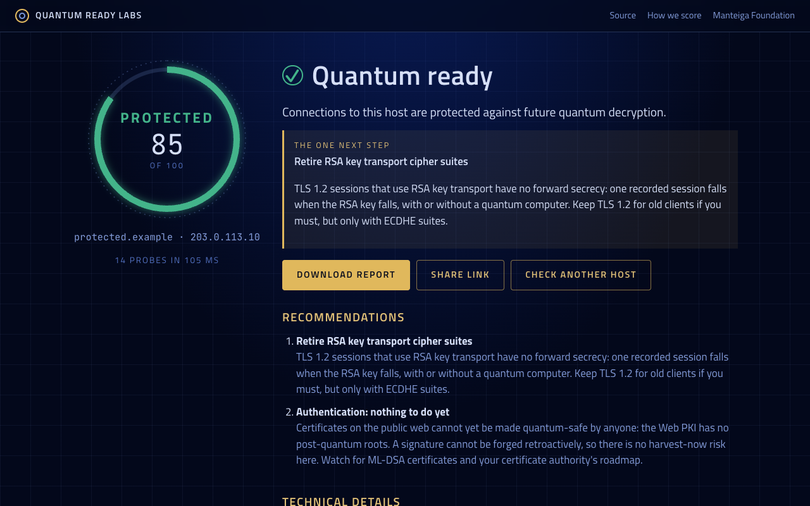
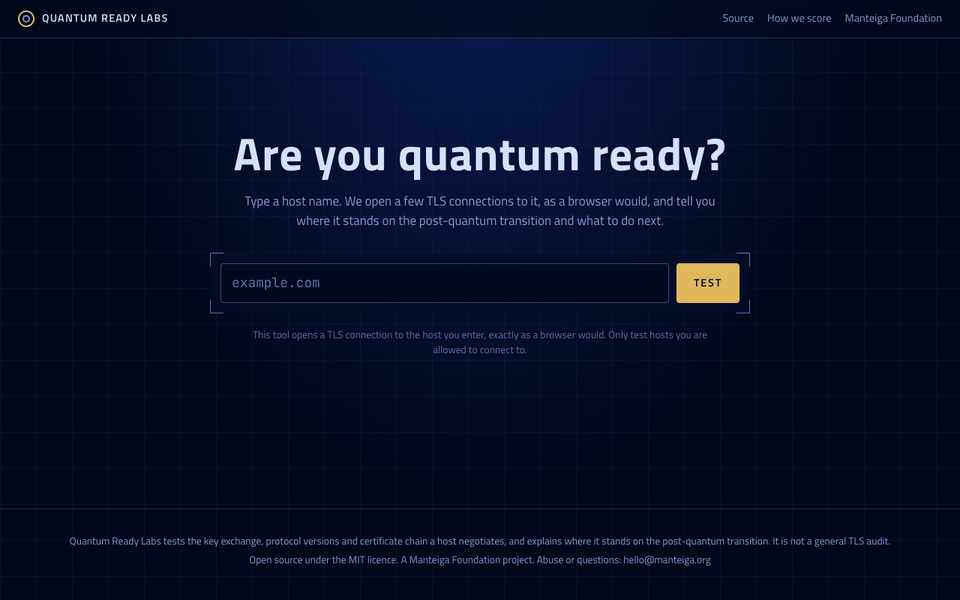
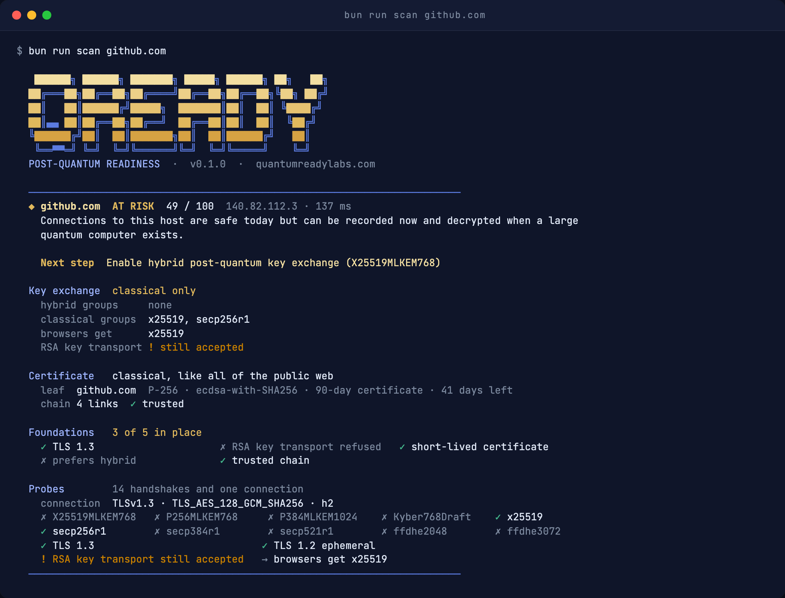

# Quantum Ready Labs

[](https://github.com/manteiga-foundation/quantum-ready-labs/actions/workflows/ci.yml)
[](https://github.com/manteiga-foundation/quantum-ready-labs/releases)
[](LICENSE)
[](https://quantumreadylabs.com)
[](https://quantumreadylabs.com/api)

Quantum Ready Labs answers one question about any public host: is it ready for the quantum era?
Type a host name, and in about a second the service opens a handful of TLS connections to it,
exactly as a browser would, and reports in plain language where the host stands on the
post-quantum transition, what is urgent, what cannot be fixed yet, and the one next step. It is
built for the people who have to decide and explain, not only for the engineers who will
implement: the result is a stage word (Exposed, At risk, Protected, Ready), a score, and a report
that can be shared by link or downloaded as a print-ready PDF. Free and open source, at https://quantumreadylabs.com.





## Why key exchange, and not the certificate

A quantum computer able to break RSA and elliptic curves does not exist. The threat today is
"harvest now, decrypt later": encrypted traffic recorded now falls when such a machine exists.
That is a confidentiality problem, and it is solved in the key exchange, which is why browsers,
OpenSSL and the large CDNs already negotiate hybrid post-quantum key exchange on every
connection that supports it.

Certificates (authentication) are a different matter. A signature cannot be forged retroactively,
so there is no harvest-now risk, and the public Web PKI has no post-quantum roots yet. The report
says so plainly and does not alarm about something nobody can act on today.

## The stages

| Stage | Meaning |
|---|---|
| Exposed | TLS 1.3 is not available. Sessions can be recorded today and decrypted later. |
| At risk | TLS 1.3 with forward secrecy, no post-quantum key exchange. Safe today, harvestable. |
| Protected | Hybrid post-quantum key exchange (X25519MLKEM768 or equivalent) is accepted. |
| Ready | Protected, no legacy key transport, short-lived automated certificates: ready for what comes next. |

The score (0 to 100) sits under the stage word; the rubric is `docs/scoring.md`. It measures
quantum readiness only and does not compete with the general TLS checkers.

## How it works

The engine builds TLS ClientHello messages by hand and reads the server's first reply in clear:
offer one key-exchange group with no key share, and a supporting server answers HelloRetryRequest
naming it, while a non-supporting server sends an alert. No post-quantum cryptography is
implemented, no handshake completes, and the result is identical on every platform. One ordinary
connection reads the negotiated parameters and the certificate chain. Fourteen probes per scan,
run concurrently: 20 to 500 ms per host.

The hosted service has three parts: the engine (Bun, on Fly Machines) that owns the sockets; the
edge (a Cloudflare Worker with D1) that validates, rate-limits, caches results for 24 hours,
serves shareable result pages with link previews and aggregates private metrics; and the views
(Vite, React, Arwes frames).

## Languages

The landing page, the report and the study pages speak English, Spanish, Brazilian Portuguese,
French, German and Japanese. English lives at the root; every other language under its own prefix (`/es/`, `/pt/`,
`/fr/`, `/de/`, `/ja/`), so each one can be indexed and a shared link opens in the language it was
shared in. A visitor arriving at an unprefixed address gets the language chosen earlier with the
selector in the top bar, otherwise the browser's language, otherwise English. The edge writes each
language's title, description, canonical address and `hreflang` alternates into the page before any
script runs, and lists every translated page in `/sitemap.xml`. The words live in `web/src/i18n/`
(a study's own prose in its entry in `web/src/study-model.ts`); the English report words are the
engine's own, and a test fails when any language misses a key. The API, the terminal and the PDF
are in English.

## API

Open, no key, for scripts, services and agents: `curl 'https://quantumreadylabs.com/api/scan?host=example.com'`
answers with the finished scan, its share link and its PDF link in one JSON object; `POST /api/scan`
streams the events the page draws from, or one object with `Accept: application/json`. Stored results
at `/api/result/<id>`, PDFs at `/api/report/<id>.pdf`. Limits: 20 scans per caller and 6 per host in any
10 minutes; results under 24 hours are served from cache. Documentation at
[quantumreadylabs.com/api](https://quantumreadylabs.com/api), machine-readable at
[/openapi.json](https://quantumreadylabs.com/openapi.json) and [/llms.txt](https://quantumreadylabs.com/llms.txt).

## Studies

A study is a named population scanned on one day and published as a state-of-readiness note:
the figures, every institution with its result page and PDF, the method and the standards.
Studies are kept apart from the scanner's organic use. The first,
[Florida's banks and credit unions](https://quantumreadylabs.com/studies/florida-financial-2026q4),
covers 81 institutions. The data is `studies/<slug>/results.csv`; the page computes every figure
from it and a test keeps the note's lead sentence in step with the file.

## In the press

The first study, on 20 October 2026:

- Quantum Zeitgeist wrote about it: [Manteiga Foundation Scans Florida Banks for Quantum Readiness](https://quantumzeitgeist.com/manteiga-foundation-scans-florida-banks/).
- The Practical Commerce Chamber newsroom wrote about it: [Florida Banks Face Quantum Readiness Gap](https://pcchamber.org/news/florida-banks-face-quantum-readiness-gap/).
- The release, issued by Manteiga Foundation on PR Newswire: [One Third of Florida's Banks and Credit Unions Not Yet Protected Against Future Quantum Decryption, Open-Source Scan Finds](https://www.prnewswire.com/news-releases/one-third-of-floridas-banks-and-credit-unions-not-yet-protected-against-future-quantum-decryption-open-source-scan-finds-302913890.html); carried by [Yahoo Finance](https://finance.yahoo.com/technology/ai/articles/one-third-floridas-banks-credit-125200422.html), [Morningstar](https://www.morningstar.com/news/pr-newswire/20261020ph75865/one-third-of-floridas-banks-and-credit-unions-not-yet-protected-against-future-quantum-decryption-open-source-scan-finds) and the [Morgan County Citizen](https://www.morgancountycitizen.com/news/national/one-third-of-floridas-banks-and-credit-unions-not-yet-protected-against-future-quantum-decryption/article_209dc6f3-62c0-534d-b1cf-ff011aecc4a9.html) among 169 outlets.

Press contact: Jaime Manteiga, Co-Founder, Manteiga Foundation, jaime@manteiga.org.

## Install and run

Everything runs on [Bun](https://bun.sh) (1.4 or later). The hosted service is at
quantumreadylabs.com; these steps give you the same tool on your own machine, from the
terminal scanner alone to the full service.

### 1. The scanner in your terminal (two minutes)

```
git clone https://github.com/manteiga-foundation/quantum-ready-labs.git
cd quantum-ready-labs
bun install
bun run scan github.com
```



That is a complete scan: the stage, the score, the verdict, the one next step, the three cards and
every probe. Useful flags: `--verbose` (chain and score breakdown), `--share` (also records the scan
at quantumreadylabs.com and prints the share and PDF links), `--json` (one result per line, for
scripts), `--private` (hosts on your own network, which the public service refuses). Several hosts
at once end with a worst-first summary.

### 2. The tests and the views

```
bunx playwright install chromium     # once: the browser the view tests and the PDF renderer use
bun run check                        # TypeScript, all three projects
bun run test                         # 180 tests: engine, edge policy, templates, languages, views in Chromium, renderer
bun run dev                          # the views on http://127.0.0.1:5180
```

`bun run dev` serves the pages with recorded scans: open `/?demo=protected`, `/?demo=exposed` or
`/?demo=at-risk` to watch a report build, `/metrics` for the private view with emulated figures,
`/api` for the documentation, and the questions under the field on `/`. Live scans need the edge (step 3).

### 3. The whole service on your machine

Three processes: the engine (owns the sockets), the renderer (prints PDFs) and the edge (validation,
limits, cache, the pages). Tokens are shared secrets between them; any random string works locally.

```
# terminal 1: the engine on :8787
ENGINE_TOKEN=local bun run engine

# terminal 2: the renderer on :8790 (needs the Chromium from step 2)
RENDER_TOKEN=local bun run render

# terminal 3: the edge on :8788, with a local database
printf 'ENGINE_TOKEN=local\nRENDER_TOKEN=local\nENGINE_URL=http://127.0.0.1:8787\nRENDER_URL=http://127.0.0.1:8790\nPUBLIC_ORIGIN=http://127.0.0.1:8788\n' > .dev.vars
bunx wrangler d1 execute qrl --local --file worker/schema.sql
bun run build
bun run edge:dev --port 8788
```

Then open http://127.0.0.1:8788 and scan a host, or from a shell:
`curl 'http://127.0.0.1:8788/api/scan?host=example.com'`. `.dev.vars` is ignored by git; the
database lives under `.wrangler/`. No Cloudflare account is needed for this step.

### 4. Deploying your own copy

The production shape is one Fly app for the engine, one for the renderer, and one Cloudflare Worker
with a D1 database for the edge. Accounts on both; `fly` and `wrangler` logged in.

```
# the engine and the renderer (edit the app names in fly.toml and fly.render.toml first)
fly apps create <engine-app> && fly apps create <render-app>
fly secrets set ENGINE_TOKEN=$(openssl rand -hex 32) -a <engine-app>
fly secrets set RENDER_TOKEN=$(openssl rand -hex 32) -a <render-app>
bun run deploy:engine
bun run deploy:render

# the edge (edit wrangler.toml: name, ENGINE_URL, RENDER_URL, PUBLIC_ORIGIN, routes, database_id)
bunx wrangler d1 create <db>                       # paste the id into wrangler.toml
bunx wrangler d1 execute <db> --remote --file worker/schema.sql
bunx wrangler secret put ENGINE_TOKEN              # the same values as above
bunx wrangler secret put RENDER_TOKEN
bun run deploy:edge
```

`/metrics` expects Cloudflare Access in front of it (any path without the Access header answers 403
except from localhost); configure a self-hosted application for `/metrics` and `/api/metrics` in
Zero Trust, or remove the check in `worker/src/index.ts` for a private deployment. The engine on
Fly stops when idle and starts on the first request; the renderer does the same and is woken by
the edge whenever a result page is viewed.

## Repository

```
engine/      the scanner: target parsing and refusal list, probes, assessment, HTTP server, terminal renderer, report and letter templates
render/      the PDF renderer: Playwright Chromium printing the templates (Fly Machines)
worker/      the edge: validation, rate limits, 24 h cache, link previews, PDFs, studies, metrics (Cloudflare Worker + D1)
web/         the views: entry, live report, API page, studies, private metrics (Vite, React, Arwes)
scripts/     screenshots, README media, OG images, studies and letters, report page review
studies/     named populations scanned with scripts/study.ts and their results
tests/       bun test: offline unit and fixture-server tests, the views in real Chromium, the renderer
spikes/      throwaway experiments with their verdicts
docs/        status, scoring rubric, screenshots, README media
```

Scoring: `docs/scoring.md`. Where things stand: `docs/status.md`. How we work: `AGENTS.md`.

## Guardrails

The public service connects only to public Internet addresses: the host is resolved first and
every address is judged against the IANA special-purpose registries (private, loopback,
link-local, CGNAT, multicast, documentation, and the IPv6 embeddings of those). Scans are
rate-limited per caller and per target, results are cached for a day, and only port 443 is
tested. A scan is a handful of TLS handshakes, the same traffic a browser visit causes; still,
only test hosts you are allowed to connect to.

## Standards referenced

NIST FIPS 203 (ML-KEM), FIPS 204 (ML-DSA), FIPS 205 (SLH-DSA); NIST IR 8547 (transition
timeline: quantum-vulnerable algorithms deprecated after 2030, disallowed after 2035); NSA CNSA
2.0; IETF draft-ietf-tls-ecdhe-mlkem (the hybrid groups).

## License

MIT. A Manteiga Foundation project. Fonts Titillium Web and JetBrains Mono (SIL Open Font
License); frames by Arwes (MIT).
